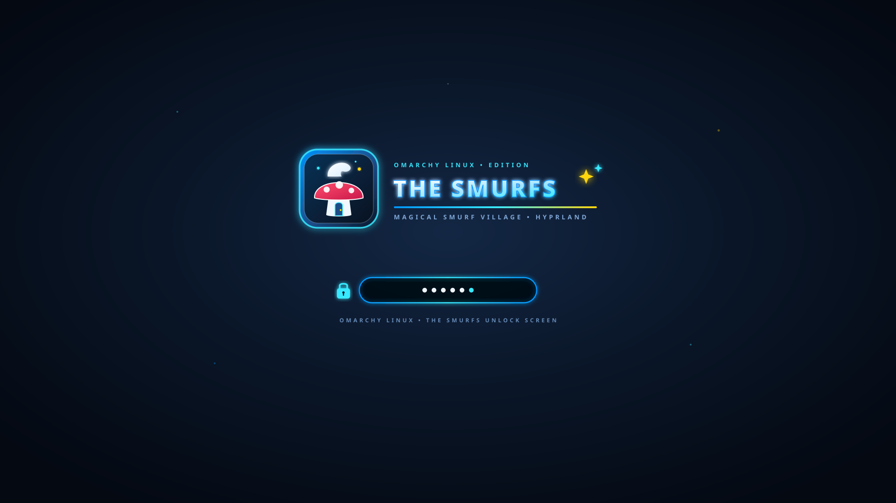

# 🍄 Şirinler (The Smurfs) Theme for Omarchy Linux

**Büyülü Şirin Köyü** atmosferini **Omarchy (Hyprland)** masaüstünüze taşıyan özel tasarım tema paketi. Canlı Şirin mavisi, büyülü orman gece laciverti ve altın sarısı vurgu renkleriyle tüm sistem yüzeylerini, **Hakkında (About)** logosunu, **Kilidi Aç (Unlock)** ekranını ve **Ekran Koruyucuyu (Screensaver)** özelleştirir.




---

## ✨ Neler İçerir?

- 🎨 **Tam Sistem Renk Paleti (`colors.toml` & `shell.toml`)**: Hyprland pencere kenarlıkları, buzlu cam (frosted glass) üst bar, bildirimler, uygulama başlatıcı (launcher), terminal emülatörleri (Alacritty, Ghostty, Foot, Kitty), Neovim ve VS Code uyumu.
- ℹ️ **Şirinler Hakkında Logosu (`about.txt`)**: `Super + Space -> Hakkında` (`omarchy-launch-about` / `fastfetch`) ekranında yalnızca Şirinler teması etkinken görünen 54x25 özel Şirinler ASCII amblemi (başka bir temaya geçildiğinde otomatik olarak varsayılan Omarchy logosuna döner).
- 🔒 **Kilidi Aç Ekranı (`unlock.png` & `preview-unlock.png`)**: `Stil -> Kilidi Aç` (`omarchy-plymouth-switcher`) menüsünden seçilebilen, mantar ev ve Şirin şapkası amblemli yüksek çözünürlüklü kilit/açılış ekranı.
- 🌌 **Şirinler Ekran Koruyucu (`screensaver.txt`)**: Omarchy'nin `ttfx` tabanlı animasyonlu ekran koruyucusu için özel **ŞİRİNLER • BÜYÜLÜ ŞİRİN KÖYÜ** ASCII sanatı.
- 🖼️ **4 Özel Duvar Kağıdı (`backgrounds/`)**:
  1. `01-sirinler-koyu.jpg` — Büyülü Şirin Köyü
  2. `02-gozluklu-sirin-ajan.jpg` — Gözlüklü Şirin Ajan
  3. `03-sirinler-buyulu-orman-gece.jpg` — Büyülü Orman Gece
  4. `04-sirin-baba-laboratuvar.jpg` — Şirin Baba'nın İksir Laboratuvarı
- 📊 **Btop Teması (`btop.theme`)**: Şirin mavisi, camgöbeği ve iksir moru geçişli sistem izleyici teması.

---

## 🚀 Kurulum

### Yöntem 1: Tam Kurulum (Önerilen — Hakkında Logosu, Ekran Koruyucu ve Kancalar Dahil)

```bash
git clone https://github.com/enisozen/omarchy-sirinler-theme.git
cd omarchy-sirinler-theme
./kur.sh
```

### Yöntem 2: Omarchy Tema Yöneticisi ile Kurulum

```bash
omarchy theme install https://github.com/enisozen/omarchy-sirinler-theme
```

Hakkında logosu ve ekran koruyucuyu da etkinleştirmek için:

```bash
cp ~/.config/omarchy/themes/sirinler/about.txt ~/.config/omarchy/branding/about.txt
cp ~/.config/omarchy/themes/sirinler/screensaver.txt ~/.config/omarchy/branding/screensaver.txt
```

---

## 🔒 Kilidi Aç (Plymouth / SDDM) Ekranını Etkinleştirme

Omarchy menüsünden (`Super + Space`):
1. **Stil (Style) > Kilidi Aç (Unlock)** menüsünü açın ve listeden **`sirinler`** seçeneğini seçin.
2. Veya terminalden doğrudan uygulayın:
   ```bash
   omarchy-plymouth-set-by-theme sirinler
   ```

---

## 📄 Lisans

MIT © [Enis Özen](https://github.com/enisozen)
