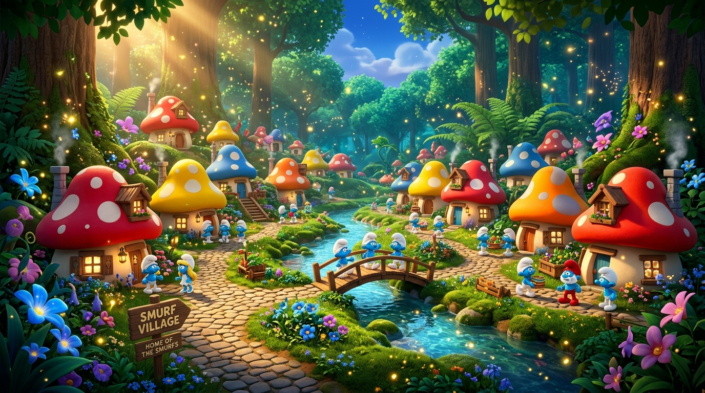
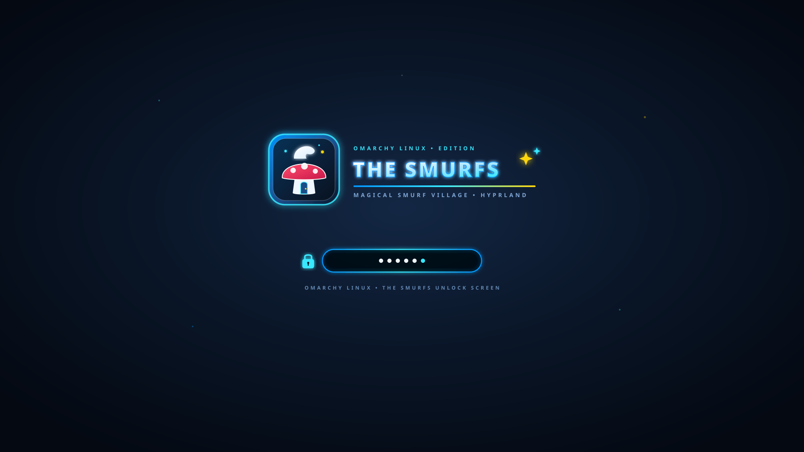

# 🍄 The Smurfs Theme for Omarchy Linux

A magical **Smurf Village** desktop theme for **[Omarchy](https://omarchy.org) (Hyprland)**. Crafted with vibrant Smurf blue (`#0095ff`), glowing potion cyan (`#38e8ff`), enchanted midnight forest navy (`#0a1628`), and golden starlight (`#ffd60a`) accents across all desktop surfaces, including a custom **About Logo**, **Unlock Screen**, and **Animated Screensaver**.

> 🇹🇷 Türkçe dokümantasyon için: **[BENIOKU.md](BENIOKU.md)**





---

## ✨ What's Included

- 🎨 **Full System Palette (`colors.toml` & `shell.toml`)**: Harmonized colors for Hyprland window borders, frosted-glass top bar, notifications, app launcher, terminals (Alacritty, Ghostty, Foot, Kitty), Neovim, and VS Code.
- ℹ️ **Custom About Logo (`about.txt`)**: A 54×25 block-ASCII mushroom house & **THE SMURFS** emblem displayed in `Super + Space -> About` (`omarchy-launch-about` / `fastfetch`). With the bundled `theme-set` hook, this custom About logo appears **only** while The Smurfs theme is active and automatically restores the stock Omarchy icon when switching to other themes.
- 🔒 **Custom Unlock Screen (`unlock.png` & `preview-unlock.png`)**: High-resolution transparent Plymouth/SDDM emblem and 1080p switcher preview featuring a glowing mushroom house, classic Smurf hat, and neon typography.
- 🌌 **Animated Screensaver (`screensaver.txt`)**: Custom **THE SMURFS • MAGICAL SMURF VILLAGE** ASCII banner for Omarchy's `ttfx` (Terminal Text Effects) screensaver.
- 🖼️ **4 High-Resolution Wallpapers (`backgrounds/`)**:
  1. `01-sirinler-koyu.jpg` — Magical Smurf Village
  2. `02-gozluklu-sirin-ajan.jpg` — Agent Brainy Smurf
  3. `03-sirinler-buyulu-orman-gece.jpg` — Enchanted Forest at Night
  4. `04-sirin-baba-laboratuvar.jpg` — Papa Smurf's Alchemy Lab
- 📊 **Btop Theme (`btop.theme`)**: Matching Smurf blue, cyan, and potion-magenta gradients for system monitoring.

---

## 🚀 Installation

### Option 1: Full Installation (Recommended — Includes About Logo, Screensaver & Auto-Sync Hook)

```bash
git clone https://github.com/enisozen/omarchy-smurfs-theme.git
cd omarchy-smurfs-theme
./install.sh
```

*(For Turkish installer, run `./kur.sh`)*

### Option 2: Via Omarchy Theme Manager

```bash
omarchy theme install https://github.com/enisozen/omarchy-smurfs-theme
```

To also apply the custom About logo and Screensaver banner manually:

```bash
cp ~/.config/omarchy/themes/smurfs/about.txt ~/.config/omarchy/branding/about.txt
cp ~/.config/omarchy/themes/smurfs/screensaver.txt ~/.config/omarchy/branding/screensaver.txt
```

---

## 🔒 Enabling the Unlock Screen (Plymouth / SDDM)

From the Omarchy Menu (`Super + Space`):
1. Open **Style > Unlock** (`omarchy-plymouth-switcher`) and select **`smurfs`** (or **`sirinler`**).
2. Or apply directly from the terminal:
   ```bash
   omarchy-plymouth-set-by-theme smurfs
   ```

---

## 📄 License

MIT © [Enis Özen](https://github.com/enisozen)
